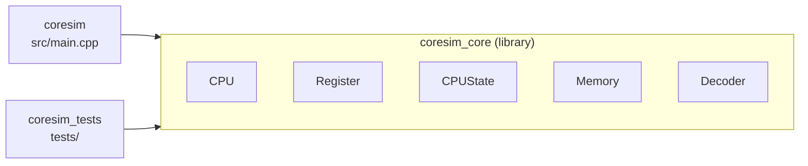
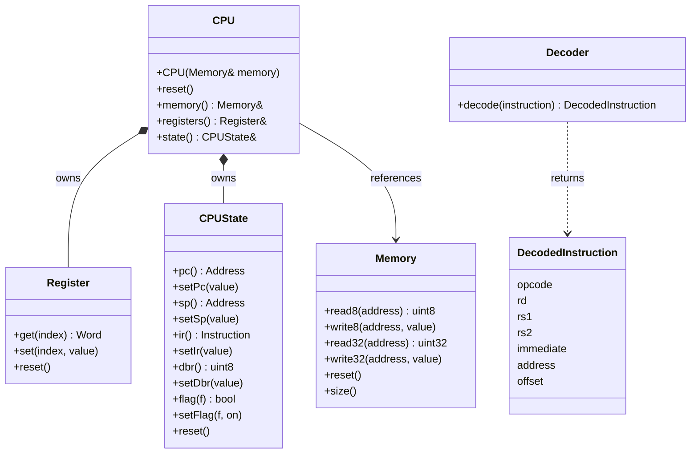
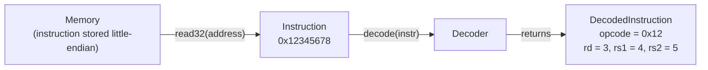

# Architecture

This document describes the components that exist in CoreSim today and how they relate to each other.

## Overview

All emulator code lives in the static library `coresim_core`. The executable `coresim` (`src/main.cpp`) and the test binary `coresim_tests` link against it.



| Component | Header | Responsibility |
|-----------|--------|----------------|
| `Architecture` | `Architecture.h` | Shared types (`Word`, `Instruction`, `Address`) and constants (`kRegisterCount`, `kMemorySize`, `kAddressMask`, `kVersion`) |
| `Memory` | `Memory.h` | 256 KB byte-addressable RAM with bounds checking → [MEMORY.md](MEMORY.md) |
| `Register` | `Register.h` | The 16 general-purpose registers R0–R15 → [REGISTERS.md](REGISTERS.md) |
| `CPUState` | `CPUState.h` | Special registers PC, SP, IR, DBR, FLAGS → [REGISTERS.md](REGISTERS.md) |
| `Decoder` | `Decoder.h` | Splits a 32-bit instruction into its fields → [DECODER.md](DECODER.md) |
| `DecodedInstruction` | `DecodedInstruction.h` | Result of decoding (plain struct) |
| `Opcode` | `Opcode.h` | Names and values of the 26 opcodes (`enum class`) → [ISA.md](ISA.md) |
| `CPU` | `CPU.h` | Groups registers, state and memory into one object |

## Shared types

Defined in `include/coresim/Architecture.h`:

| Name | Definition | Meaning |
|------|------------|---------|
| `Word` | `std::uint16_t` | One 16-bit machine word (register width) |
| `Instruction` | `std::uint32_t` | One fixed-length 32-bit instruction |
| `Address` | `std::uint32_t` | Physical address; only the lower 18 bits are used |
| `kRegisterCount` | `16` | Number of general-purpose registers |
| `kAddressBits` | `18` | Address width |
| `kMemorySize` | `1 << 18` = 262,144 | RAM size in bytes (256 KB) |
| `kAddressMask` | `0x3FFFF` | Mask that keeps the lower 18 bits |
| `kVersion` | `"0.1"` | Version string printed by `coresim` |

## Ownership



- **`CPU` owns** a `Register` and a `CPUState` as members. They are created and destroyed together with the CPU.
- **`CPU` references** a `Memory`. The memory is created outside and passed into the constructor, so it must outlive the CPU:

  ```cpp
  Memory memory;
  CPU cpu(memory);
  ```

- **`Decoder` is stand-alone.** It is not part of the CPU and has no state. Its nested enum `Decoder::Format` (R, I, M, J) is selected from the top 2 opcode bits.

`CPU::reset()` resets the registers and the CPU state. It does **not** clear memory; use `Memory::reset()` for that.

## Data flow

The CPU does not fetch, decode or execute instructions on its own yet. The flow from RAM to decoded fields is currently done by calling the classes directly:



```cpp
Memory memory;
memory.write32(0x100, 0x12345678);

Instruction instr = memory.read32(0x100);
DecodedInstruction d = Decoder().decode(instr);
// d.opcode == 0x12, d.rd == 3, d.rs1 == 4, d.rs2 == 5
```

## Error handling

Invalid accesses throw `std::out_of_range`:

| Where | Condition |
|-------|-----------|
| `Memory` | Any byte of the access lies outside `0x00000`–`0x3FFFF` |
| `Register` | Register index ≥ 16 |

`CPUState` setters never throw. They mask values to the register's bit width instead (see [REGISTERS.md](REGISTERS.md)).

## Diagrams

| File | Content |
|------|---------|
| [`registers-memory.drawio`](../diagrams/registers-memory.drawio) | Page *Registers*: R0–R15, special registers, masking, flags · Page *Memory*: address space, little-endian, bounds checking |
| [`data-flow.drawio`](../diagrams/data-flow.drawio) | Build targets, component ownership, data flow from RAM to `DecodedInstruction`, error handling |
| [`decoder.drawio`](../diagrams/decoder.drawio) | Page *Formats*: format selection, R/I/M/J bit layouts, `DecodedInstruction`. Page *Shift & Mask*: extraction rule, examples, tested values |
| [`isa.drawio`](../diagrams/isa.drawio) | Opcode map of all 256 values by format, opcodes grouped as in `Opcode.h` |

Open them with [draw.io](https://www.drawio.com/) (desktop app or browser).
