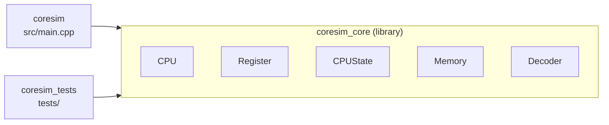
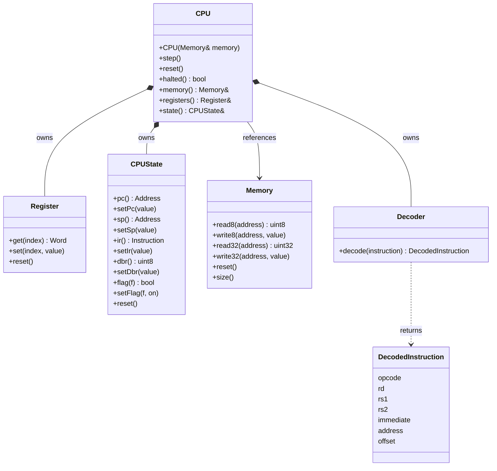
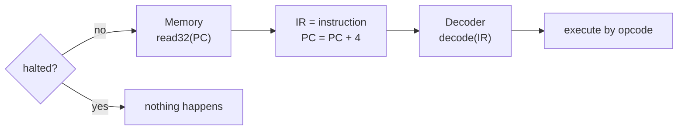

# Architecture

This document describes the components that exist in CoreSim today and how they relate to each other.

## Overview

All emulator code lives in the static library `coresim_core`. The executable `coresim` (`src/main.cpp`) and the test binary `coresim_tests` link against it.



| Component | Header | Responsibility |
|-----------|--------|----------------|
| `Architecture` | `Architecture.h` | Shared types (`Word`, `Instruction`, `Address`) and constants (`kRegisterCount`, `kMemorySize`, `kAddressMask`, `kVersion`) |
| `Memory` | `Memory.h` | 256 KB byte-addressable RAM with bounds checking → [MEMORY.md](MEMORY.md) |
| `Register` | `Register.h` | The 16 general-purpose registers R0–R15 → [REGISTERS.md](REGISTERS.md) |
| `CPUState` | `CPUState.h` | Special registers PC, SP, IR, DBR, FLAGS → [REGISTERS.md](REGISTERS.md) |
| `Decoder` | `Decoder.h` | Splits a 32-bit instruction into its fields → [DECODER.md](DECODER.md) |
| `DecodedInstruction` | `DecodedInstruction.h` | Result of decoding (plain struct) |
| `Opcode` | `Opcode.h` | Names and values of the 26 opcodes (`enum class`) → [ISA.md](ISA.md) |
| `CPU` | `CPU.h` | Groups registers, state, decoder and memory; `step()` fetches, decodes and executes one instruction |

## Shared types

Defined in `include/coresim/Architecture.h`:

| Name | Definition | Meaning |
|------|------------|---------|
| `Word` | `std::uint16_t` | One 16-bit machine word (register width) |
| `Instruction` | `std::uint32_t` | One fixed-length 32-bit instruction |
| `Address` | `std::uint32_t` | Physical address; only the lower 18 bits are used |
| `kRegisterCount` | `16` | Number of general-purpose registers |
| `kAddressBits` | `18` | Address width |
| `kMemorySize` | `1 << 18` = 262,144 | RAM size in bytes (256 KB) |
| `kAddressMask` | `0x3FFFF` | Mask that keeps the lower 18 bits |
| `kVersion` | `"0.1"` | Version string printed by `coresim` |

## Ownership



- **`CPU` owns** a `Register`, a `CPUState` and a `Decoder` as members. They are created and destroyed together with the CPU.
- **`CPU` references** a `Memory`. The memory is created outside and passed into the constructor, so it must outlive the CPU:

  ```cpp
  Memory memory;
  CPU cpu(memory);
  ```

- **`Decoder` has no state.** The CPU uses it in `step()`. It can also be used on its own (`Decoder().decode(instr)`). Its nested enum `Decoder::Format` (R, I, M, J) is selected from the top 2 opcode bits.

`CPU::reset()` resets the registers and the CPU state and clears the halted state. It does **not** clear memory; use `Memory::reset()` for that.

## Data flow

`CPU::step()` runs one instruction:



| Step | Code |
|------|------|
| 1. Stop if halted | `if (halted_) return;` |
| 2. Fetch into IR | `state_.setIr(memory_.read32(state_.pc()))` |
| 3. Advance PC | `state_.setPc(state_.pc() + 4)` |
| 4. Decode | `decoder_.decode(instruction)` |
| 5. Execute | `switch` on `Opcode` |

Only six opcodes are executed so far. All others are decoded but do nothing:

| Opcode | Effect |
|--------|--------|
| `NOP` (`0x0D`) | nothing |
| `HLT` (`0x0E`) | sets the halted state, further `step()` calls do nothing until `reset()` |
| `MOV` (`0x00`) | `R[rd] = R[rs1]` |
| `MOVI` (`0x40`) | `R[rd] = imm` |
| `ADD` (`0x01`) | `R[rd] = (R[rs1] + R[rs2]) & 0xFFFF`, updates Z, N, C, V |
| `ADDI` (`0x41`) | `R[rd] = (R[rs1] + imm) & 0xFFFF`, updates Z, N, C, V |

`ADD` and `ADDI` share the private helper `addWithFlags(a, b)`, which computes the result and updates the flags.

```cpp
Memory memory;
memory.write32(0x0000, 0x0D000000);   // NOP
memory.write32(0x0004, 0x0E000000);   // HLT

CPU cpu(memory);
cpu.step();   // IR = 0x0D000000, PC = 0x0004
cpu.step();   // IR = 0x0E000000, PC = 0x0008, cpu.halted() == true
cpu.step();   // nothing happens, PC stays 0x0008
```

The full behaviour of every instruction is specified in [ISA.md](ISA.md).

## Error handling

Invalid accesses throw `std::out_of_range`:

| Where | Condition |
|-------|-----------|
| `Memory` | Any byte of the access lies outside `0x00000`–`0x3FFFF` |
| `Register` | Register index ≥ 16 |

`CPUState` setters never throw. They mask values to the register's bit width instead (see [REGISTERS.md](REGISTERS.md)).

## Diagrams

| File | Content |
|------|---------|
| [`registers-memory.drawio`](../diagrams/registers-memory.drawio) | Page *Registers*: R0–R15, special registers, masking, flags · Page *Memory*: address space, little-endian, bounds checking |
| [`data-flow.drawio`](../diagrams/data-flow.drawio) | Build targets, component ownership, data flow from RAM to `DecodedInstruction`, error handling |
| [`decoder.drawio`](../diagrams/decoder.drawio) | Page *Formats*: format selection, R/I/M/J bit layouts, `DecodedInstruction`. Page *Shift & Mask*: extraction rule, examples, tested values |
| [`isa.drawio`](../diagrams/isa.drawio) | Opcode map of all 256 values by format, opcodes grouped as in `Opcode.h` |

Open them with [draw.io](https://www.drawio.com/) (desktop app or browser).
