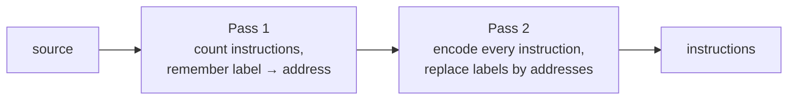

# Assembler

> **Specification, not implemented yet.** This document defines the assembly language for CoreSim-16 and how the assembler translates it into instructions. Nothing in it exists in the code so far. Programs are currently written in the hex text format (see [LOADER.md](LOADER.md)).

## Why an assembler

In hex, every instruction has to be encoded by hand, and every jump target has to be recalculated when an instruction is added or removed. The assembler does both:

```
; countdown.asm - counts down from 3 to 1
        MOVI R1, 3
loop:   OUT  R1
        ADDI R1, R1, -1
        JNZ  loop
        HLT
```

becomes exactly the program in [examples/countdown.hex](../examples/countdown.hex):

```
40100003
0F010000
4111FFFF
C2000004
0E000000
```

## Running

`coresim` decides by the file extension:

| Command | What happens |
|---------|--------------|
| `coresim program.hex` | load with `loadHex()` and run (implemented) |
| `coresim program.asm` | assemble, then run (specified here) |

The assembler is its own component in `coresim_core`, independent of the CPU and the loader.

## Syntax

One line holds at most one instruction:

```
[label:]  [MNEMONIC operand, operand, ...]  [; comment]
```

| Rule | Definition |
|------|------------|
| Comment | from `;` to the end of the line |
| Whitespace | spaces and tabs between the parts are ignored, at least one is needed between mnemonic and first operand |
| Empty lines | ignored, including lines that only hold a comment |
| Mnemonic | one of the 26 names from [ISA.md](ISA.md), letter case is ignored (`movi` = `MOVI`) |
| Operands | separated by `,`, spaces around the comma are allowed |
| Register | `R0` to `R15`, letter case is ignored (`r1` = `R1`) |
| Label | see [Labels](#labels) |

## Operands

Each instruction takes exactly the operands from the [ISA operand table](ISA.md#operands):

| Instruction | Syntax |
|-------------|--------|
| `MOV`, `NOT` | `MOV rd, rs1` |
| `ADD`, `SUB`, `MUL`, `DIV`, `AND`, `OR`, `XOR` | `ADD rd, rs1, rs2` |
| `CMP` | `CMP rs1, rs2` |
| `PUSH`, `OUT` | `PUSH rs1` |
| `POP` | `POP rd` |
| `RET`, `NOP`, `HLT` | no operands |
| `MOVI` | `MOVI rd, imm` |
| `ADDI` | `ADDI rd, rs1, imm` |
| `LOAD` | `LOAD rd, [rs1 + offset]` |
| `STORE` | `STORE rs, [rs1 + offset]` |
| `JMP`, `JZ`, `JNZ`, `JN`, `JC`, `CALL` | `JMP target` |

### Numbers

| Form | Example | Value |
|------|---------|-------|
| decimal | `42` | `0x002A` |
| negative decimal | `-1` | `0xFFFF` (two's complement) |
| hex | `0x1C` or `0X1C` | `0x001C` |

| Field | Allowed range |
|-------|---------------|
| `imm` (`MOVI`, `ADDI`) | `-32768` to `65535`, stored as 16 bit |
| `offset` (`LOAD`, `STORE`) | `-32768` to `32767` |
| jump `target` as a number | `0` to `0x3FFFF` |

`imm` accepts both signed and unsigned values, because `ADDI R1, R1, -1` and `MOVI R1, 0xFFFF` are both common and give the same 16 bits.

### Memory operands

The address of `LOAD` and `STORE` is written in square brackets:

| Written | `rs1` | `offset` |
|---------|-------|----------|
| `[R2]` | 2 | 0 |
| `[R2 + 8]` | 2 | 8 |
| `[R2 - 4]` | 2 | −4 |

### Jump targets

A jump target is either a label or a number:

```
JNZ loop        ; label
JMP 0x00100     ; absolute address
```

## Labels

```
loop:   OUT R1          ; label and instruction in one line
end:                    ; label alone, refers to the next instruction
        HLT
```

| Rule | Definition |
|------|------------|
| Name | starts with a letter or `_`, then letters, digits or `_` |
| Letter case | matters, `loop` and `Loop` are different labels |
| Value | the address of the instruction it marks; a label in an otherwise empty line marks the next instruction |
| Definition | each label may be defined only once |
| Use | only as a jump target (`JMP`, `JZ`, `JNZ`, `JN`, `JC`, `CALL`) |
| Reserved | a register name (`R0`–`R15`) or a mnemonic cannot be a label |

### Two passes

A jump may use a label that is defined further down, so the assembler reads the program twice:



1. **Pass 1:** go through all lines, give every instruction its address (`0x00000`, `0x00004`, ...) and store each label with its address.
2. **Pass 2:** encode every instruction. A label used as a jump target is replaced by the address from pass 1.

## Encoding

Each instruction is encoded in its format from [DECODER.md](DECODER.md). Fields an instruction does not use are `0`.

| Format | Layout | Example | Result |
|--------|--------|---------|--------|
| R | `opcode 8 \| rd 4 \| rs1 4 \| rs2 4 \| 0 12` | `ADD R4, R1, R2` | `01412000` |
| R | | `OUT R1` (`rs1`) | `0F010000` |
| R | | `POP R2` (`rd`) | `0B200000` |
| I | `opcode 8 \| rd 4 \| rs1 4 \| imm 16` | `ADDI R1, R1, -1` | `4111FFFF` |
| M | `opcode 8 \| rd 4 \| rs1 4 \| offset 16` | `LOAD R3, [R1 + 8]` | `80310008` |
| M | | `STORE R2, [R1 + 8]` (`rs` in the `rd` field) | `81210008` |
| J | `opcode 8 \| 0 6 \| address 18` | `JNZ loop` with `loop` = `0x00004` | `C2000004` |

## Errors

Like the loader, the assembler throws `std::runtime_error` with the line number, counted from 1 including comment and empty lines:

```
line 4: unknown instruction 'MOVE'
```

| Problem | Example |
|---------|---------|
| unknown mnemonic | `MOVE R1, 3` |
| wrong number of operands | `ADD R1, R2` |
| wrong kind of operand | `ADD R1, R2, 3` (register expected) |
| invalid register | `R16`, `RX` |
| number out of range | `MOVI R1, 70000`, `LOAD R1, [R2 + 40000]` |
| malformed memory operand | `LOAD R1, R2 + 4` (brackets missing) |
| unknown label | `JNZ lop` |
| label defined twice | `loop:` in two lines |
| invalid label name | `1loop:`, `R1:` |

Nothing is loaded into memory if the program contains an error.

## Not part of this specification

- data directives (e.g. reserving or initialising memory),
- labels as values for `MOVI` or `LOAD`/`STORE`,
- expressions such as `loop + 4`,
- writing the assembled program to a `.hex` file.
