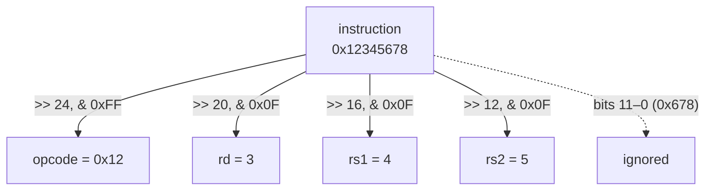

# Instruction Decoder

`Decoder` (`include/coresim/Decoder.h`, `src/Decoder.cpp`) splits a 32-bit instruction into its fields and returns them as a `DecodedInstruction`.

```cpp
Decoder decoder;
DecodedInstruction d = decoder.decode(0x12345678);
// d.opcode == 0x12, d.rd == 3, d.rs1 == 4, d.rs2 == 5
```

## Instruction format (R-format)

The decoder currently supports one format with three register operands:

```
 31        24 23    20 19    16 15    12 11                 0
+------------+--------+--------+--------+--------------------+
|   opcode   |   rd   |  rs1   |  rs2   |      (unused)      |
|   8 bit    | 4 bit  | 4 bit  | 4 bit  |       12 bit       |
+------------+--------+--------+--------+--------------------+
```

| Field | Bits | Width | Meaning |
|-------|------|-------|---------|
| `opcode` | 31–24 | 8 | Operation code |
| `rd` | 23–20 | 4 | Destination register (R0–R15) |
| `rs1` | 19–16 | 4 | Source register 1 (R0–R15) |
| `rs2` | 15–12 | 4 | Source register 2 (R0–R15) |
| — | 11–0 | 12 | Ignored by the decoder |

A 4-bit register field can hold the values 0–15, exactly one per general-purpose register.

## How decoding works

Each field is extracted in two steps:

1. **Shift right** (`>>`) so the field ends up in the lowest bits.
2. **Mask** (`&`) to keep only the bits of that field (`0xFF` = 8 bits, `0x0F` = 4 bits).

```cpp
decoded.opcode = (instruction >> 24) & 0xFF;
decoded.rd     = (instruction >> 20) & 0x0F;
decoded.rs1    = (instruction >> 16) & 0x0F;
decoded.rs2    = (instruction >> 12) & 0x0F;
```



### Worked example: `0x12345678`

```
hex     1    2    3    4    5    6    7    8
bin  0001 0010 0011 0100 0101 0110 0111 1000
     \_opcode_/ \rd/ \rs1/\rs2/ \__unused__/
```

| Field | Operation | Intermediate | Result |
|-------|-----------|--------------|--------|
| `opcode` | `>> 24` then `& 0xFF` | `0x12` | `0x12` |
| `rd` | `>> 20` then `& 0x0F` | `0x123` | `0x3` |
| `rs1` | `>> 16` then `& 0x0F` | `0x1234` | `0x4` |
| `rs2` | `>> 12` then `& 0x0F` | `0x12345` | `0x5` |

The mask removes everything left of the field. For `rd`, `0x123 & 0x0F` keeps only the last hex digit, `3`.

## `DecodedInstruction`

`decode()` returns this struct (`include/coresim/DecodedInstruction.h`):

| Member | Type | Filled by `decode()` |
|--------|------|----------------------|
| `opcode` | `uint8_t` | ✅ bits 31–24 |
| `rd` | `uint8_t` | ✅ bits 23–20 |
| `rs1` | `uint8_t` | ✅ bits 19–16 |
| `rs2` | `uint8_t` | ✅ bits 15–12 |
| `immediate` | `uint16_t` | ❌ always `0` |
| `address` | `uint32_t` | ❌ always `0` |
| `offset` | `int32_t` | ❌ always `0` |

The struct is value-initialized (`DecodedInstruction decoded{};`), so all members that are not set stay `0`.

## Current behaviour

- The decoder does not check the opcode. Every 8-bit value is accepted, and no opcode has a meaning yet.
- The decoder has no state. `decode()` only depends on its input.
- `src/main.cpp` decodes `0xFFFFFFFF` as a demo and prints `Opcode 255`, `RD 15`, `RS1 15`, `RS2 15`.
