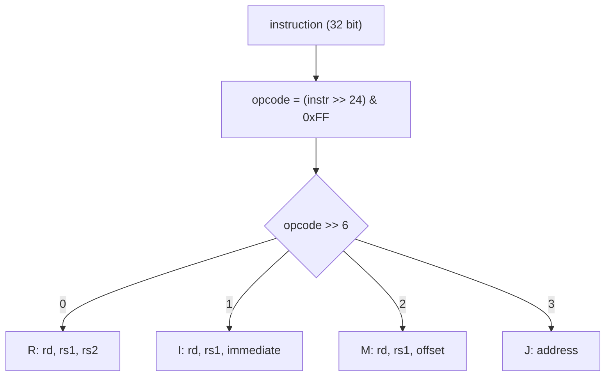

# Instruction Decoder

`Decoder` (`include/coresim/Decoder.h`, `src/Decoder.cpp`) splits a 32-bit instruction into its fields and returns them as a `DecodedInstruction`.

```cpp
Decoder decoder;
DecodedInstruction d = decoder.decode(0x12345000);
// d.opcode == 0x12, d.rd == 3, d.rs1 == 4, d.rs2 == 5
```

Decoding happens in two steps:

1. Read the **opcode** (bits 31–24) and pick the **format** from it.
2. Extract the fields of that format.

## Format selection

The opcode says *what* an instruction does, the format says *how its 32 bits are split*. The top 2 bits of the opcode select the format:

```cpp
decoded.opcode = (instruction >> 24) & 0xFF;
Format format  = static_cast<Format>(decoded.opcode >> 6);
```

| Opcode bits 7–6 | Opcode range | Format | `Decoder::Format` | Operands |
|-----------------|--------------|--------|-------------------|----------|
| `00` | `0x00`–`0x3F` | R | `kFormatR` | 3 registers |
| `01` | `0x40`–`0x7F` | I | `kFormatI` | 2 registers + immediate |
| `10` | `0x80`–`0xBF` | M | `kFormatM` | 2 registers + offset |
| `11` | `0xC0`–`0xFF` | J | `kFormatJ` | address |

`opcode >> 6` can only be 0–3, so every opcode belongs to exactly one format. There is no invalid case.



## Formats

The opcode is always in bits 31–24. A 4-bit register field holds 0–15, one value per general-purpose register R0–R15.

```
 31        24 23    20 19    16 15    12 11                 0
+------------+--------+--------+--------+--------------------+
|   opcode   |   rd   |  rs1   |  rs2   |      (unused)      |   R
+------------+--------+--------+--------+--------------------+
|   opcode   |   rd   |  rs1   |          immediate          |   I
+------------+--------+--------+-----------------------------+
|   opcode   |   rd   |  rs1   |       offset (signed)       |   M
+------------+--------+--------+-----------------------------+
|   opcode   | unused |               address                |   J
+------------+--------+--------------------------------------+
 31        24 23    18 17                                   0
```

| Format | Field | Bits | Width | Extraction |
|--------|-------|------|-------|------------|
| all | `opcode` | 31–24 | 8 | `(instruction >> 24) & 0xFF` |
| R, I, M | `rd` | 23–20 | 4 | `(instruction >> 20) & 0x0F` |
| R, I, M | `rs1` | 19–16 | 4 | `(instruction >> 16) & 0x0F` |
| R | `rs2` | 15–12 | 4 | `(instruction >> 12) & 0x0F` |
| I | `immediate` | 15–0 | 16 | `instruction & 0xFFFF` |
| M | `offset` | 15–0 | 16 | `static_cast<int16_t>(instruction & 0xFFFF)` |
| J | `address` | 17–0 | 18 | `instruction & kAddressMask` |

Bits 11–0 in R and bits 23–18 in J are ignored.

The decoder only extracts the fields. Which of them an instruction uses is specified in [ISA.md](ISA.md#operands). For `STORE`, the `rd` field holds the register whose value is stored.

## How fields are extracted

Each field is extracted in two steps:

1. **Shift right** (`>>`) by the field's lowest bit number, so the field ends up in the lowest bits.
2. **Mask** (`&`) with as many 1-bits as the field is wide.

| Width | Mask |
|-------|------|
| 4 | `0x0F` |
| 8 | `0xFF` |
| 16 | `0xFFFF` |
| 18 | `0x3FFFF` (`kAddressMask`) |

Fields that start at bit 0 (`immediate`, `offset`, `address`) need no shift.

### Example: `rd` of `0x12345000`

```
instr        0001 0010 0011 0100 0101 0000 0000 0000   0x12345000
instr >> 20                 0001 0010 0011             0x123
& 0x0F                      0000 0000 1111
= rd                                  0011             3
```

### Example: `offset` of `0x8012FFFC`

The offset of the M-format is **signed**, so it can also be negative (e.g. base register minus 4).

```
instr & 0xFFFF                      1111 1111 1111 1100   0xFFFC
as uint16_t                                               65532
static_cast<int16_t>   bit 15 = 1 → negative             -4
stored in int32_t      sign kept (0xFFFFFFFC)             -4
```

The cast to `int16_t` reads bit 15 as the sign. Converting it to the `int32_t` member keeps the sign (sign extension). For `0x80120008`, bit 15 is 0 and the offset stays `+8`.

### Example: `address` of `0xFFFFFFFF`

```
instr          1111 1111 1111 1111 1111 1111 1111 1111   0xFFFFFFFF
& kAddressMask 0000 0000 0000 0011 1111 1111 1111 1111   0x3FFFF
= address      0000 0000 0000 0011 1111 1111 1111 1111   0x3FFFF
```

The mask keeps the 18 address bits, so the address is always inside the memory (`0x00000`–`0x3FFFF`).

## `DecodedInstruction`

`decode()` returns this struct (`include/coresim/DecodedInstruction.h`):

| Member | Type | Filled in format |
|--------|------|------------------|
| `opcode` | `uint8_t` | R, I, M, J |
| `rd` | `uint8_t` | R, I, M |
| `rs1` | `uint8_t` | R, I, M |
| `rs2` | `uint8_t` | R |
| `immediate` | `uint16_t` | I |
| `offset` | `int32_t` | M |
| `address` | `uint32_t` | J |

The struct is value-initialized (`DecodedInstruction decoded{};`), so every member the format does not use stays `0`. For example, a J-format instruction always has `rd == rs1 == rs2 == 0`.

## Current behaviour

- Opcodes only select the format. Their names and values are defined in `Opcode.h` (see [ISA.md](ISA.md)), but the decoder does not use them and no instruction is executed yet.
- The decoder has no state. `decode()` only depends on its input.
- Tested examples (`tests/test_decoder.cpp`):

| Instruction | Format | Expected fields |
|-------------|--------|-----------------|
| `0x12345000` | R | opcode `0x12`, rd 3, rs1 4, rs2 5 |
| `0x4123ABCD` | I | opcode `0x41`, rd 2, rs1 3, immediate `0xABCD` |
| `0x8012FFFC` | M | opcode `0x80`, rd 1, rs1 2, offset −4 |
| `0x80120008` | M | offset +8 |
| `0xC0012345` | J | opcode `0xC0`, address `0x12345` |
| `0xFFFFFFFF` | J | opcode `0xFF`, address `0x3FFFF`, rd 0 |
