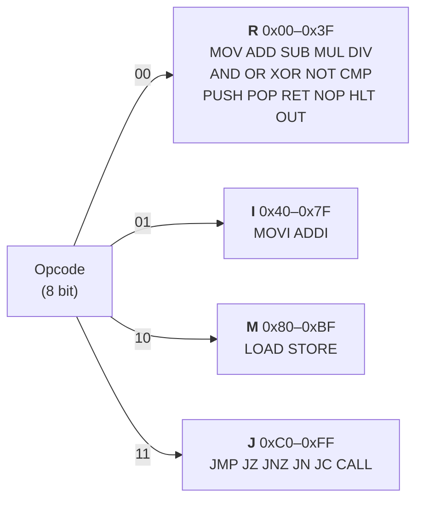

# Instruction Set (ISA)

`Opcode` (`include/coresim/Opcode.h`) names the 26 opcodes of CoreSim-16.

```cpp
enum class Opcode : std::uint8_t { MOV = 0x00, ADD = 0x01, /* ... */ JC = 0xC4 };
```

Currently an opcode only has a **name**, a **value** and a **format**. The decoder does not use the enum, and the CPU does not execute any instruction yet.

## Opcode space

An opcode has 8 bits, so there are 256 possible values. The top 2 bits select the instruction format (see [DECODER.md](DECODER.md)):

| Opcode bits 7–6 | Range | Format | Fields available | Used |
|-----------------|-------|--------|------------------|------|
| `00` | `0x00`–`0x3F` | R | `rd`, `rs1`, `rs2` | 16 of 64 |
| `01` | `0x40`–`0x7F` | I | `rd`, `rs1`, `immediate` | 2 of 64 |
| `10` | `0x80`–`0xBF` | M | `rd`, `rs1`, `offset` | 2 of 64 |
| `11` | `0xC0`–`0xFF` | J | `address` | 6 of 64 |

The value of an opcode therefore decides its format. `ADDI = 0x41` = `01`00 0001 is an I-format instruction.



## All opcodes

Grouped as in `Opcode.h`:

| Group | Opcode | Value | Format |
|-------|--------|-------|--------|
| transfer register values | `MOV` | `0x00` | R |
| | `MOVI` | `0x40` | I |
| calculate | `ADD` | `0x01` | R |
| | `SUB` | `0x02` | R |
| | `MUL` | `0x03` | R |
| | `DIV` | `0x04` | R |
| | `ADDI` | `0x41` | I |
| bitoperations | `AND` | `0x05` | R |
| | `OR` | `0x06` | R |
| | `XOR` | `0x07` | R |
| | `NOT` | `0x08` | R |
| compare values | `CMP` | `0x09` | R |
| stackoperations | `PUSH` | `0x0A` | R |
| | `POP` | `0x0B` | R |
| | `RET` | `0x0C` | R |
| | `CALL` | `0xC5` | J |
| cpu control | `NOP` | `0x0D` | R |
| | `HLT` | `0x0E` | R |
| output | `OUT` | `0x0F` | R |
| memory accesses | `LOAD` | `0x80` | M |
| | `STORE` | `0x81` | M |
| jumps | `JMP` | `0xC0` | J |
| | `JZ` | `0xC1` | J |
| | `JNZ` | `0xC2` | J |
| | `JN` | `0xC3` | J |
| | `JC` | `0xC4` | J |

Every value is written out explicitly. An `enum` would otherwise count up from the previous value, and the values jump between the format ranges (`0x0F` → `0x40` → `0x80` → `0xC0`).

## Opcode map

Row = high hex digit, column = low hex digit. `·` is a free opcode.

```
      _0    _1    _2    _3    _4    _5    _6    _7    _8    _9    _A    _B    _C    _D    _E    _F
R 0_  MOV   ADD   SUB   MUL   DIV   AND   OR    XOR   NOT   CMP   PUSH  POP   RET   NOP   HLT   OUT
  1_  ·     ·     ·     ·     ·     ·     ·     ·     ·     ·     ·     ·     ·     ·     ·     ·
  2_  ·     ·     ·     ·     ·     ·     ·     ·     ·     ·     ·     ·     ·     ·     ·     ·
  3_  ·     ·     ·     ·     ·     ·     ·     ·     ·     ·     ·     ·     ·     ·     ·     ·
I 4_  MOVI  ADDI  ·     ·     ·     ·     ·     ·     ·     ·     ·     ·     ·     ·     ·     ·
  5_–7_  free
M 8_  LOAD  STORE ·     ·     ·     ·     ·     ·     ·     ·     ·     ·     ·     ·     ·     ·
  9_–B_  free
J C_  JMP   JZ    JNZ   JN    JC    CALL  ·     ·     ·     ·     ·     ·     ·     ·     ·     ·
  D_–F_  free
```

The full map is in [`diagrams/isa.drawio`](../diagrams/isa.drawio).

## Using `Opcode` in code

`enum class` does not convert to a number on its own. This prevents mixing up an opcode with, for example, a register number:

```cpp
Opcode::ADD == 0x01;                          // compile error
static_cast<uint8_t>(Opcode::ADD) == 0x01;    // OK
```

Getting the format of an opcode works like in the decoder:

```cpp
static_cast<uint8_t>(Opcode::LOAD) >> 6 == Decoder::kFormatM;   // true
```

Building an instruction from an opcode and decoding it again:

```cpp
Instruction instr = (static_cast<uint32_t>(Opcode::ADD) << 24)
                  | (1 << 20) | (2 << 16) | (3 << 12);         // 0x01123000

DecodedInstruction d = Decoder().decode(instr);
// d.opcode == 0x01 (ADD), d.rd == 1, d.rs1 == 2, d.rs2 == 3
```

## Tests

`tests/test_isa.cpp` (suite `Isa`) checks the value of all 26 opcodes and that each one lies in the range of its format. See [TESTING.md](TESTING.md).
