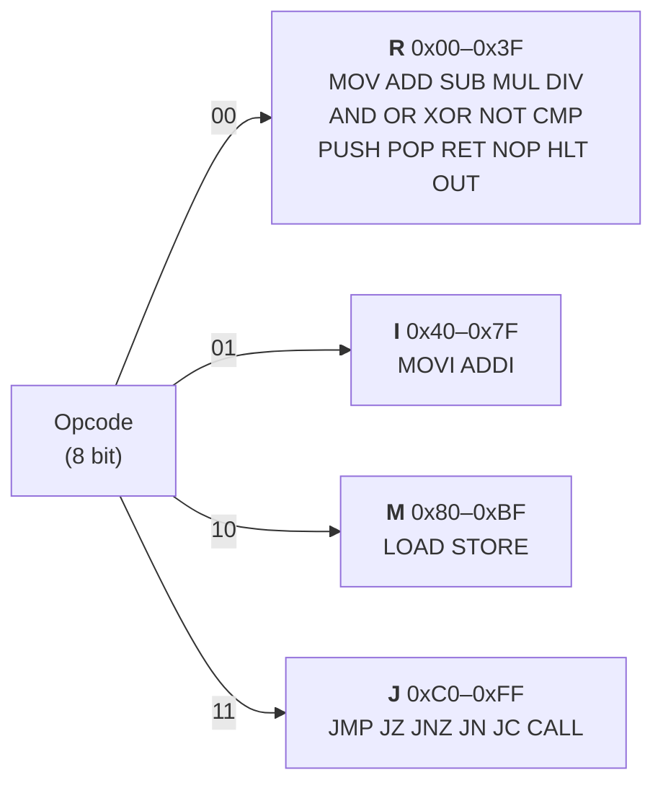
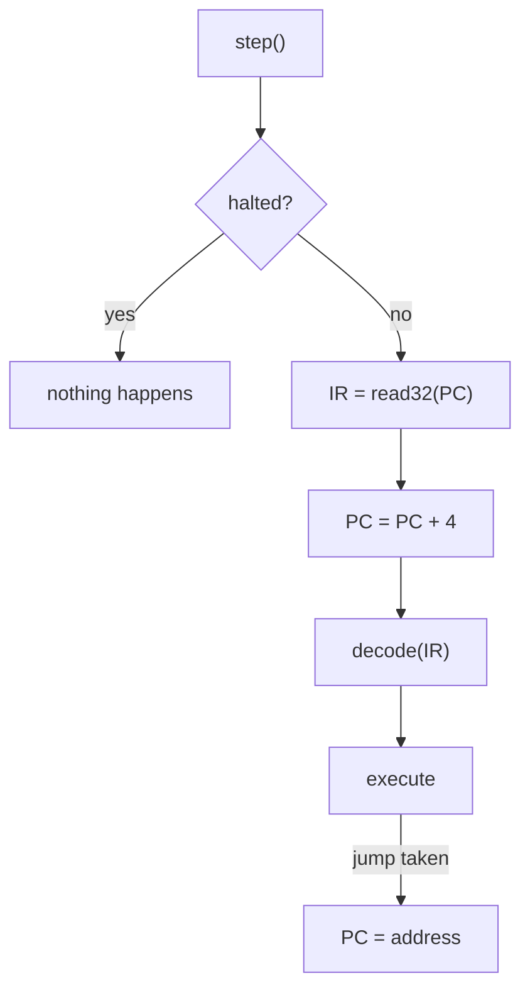
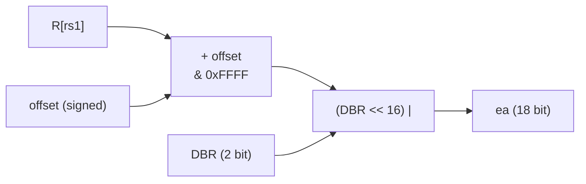

# Instruction Set (ISA)

`Opcode` (`include/coresim/Opcode.h`) names the 26 opcodes of CoreSim-16.

```cpp
enum class Opcode : std::uint8_t { MOV = 0x00, ADD = 0x01, /* ... */ JC = 0xC4 };
```

The sections [Operands](#operands) to [Stack operations](#stack-operations) specify how each instruction behaves. Only a small part of it is implemented so far.

## Implementation status

| Part | Status |
|------|--------|
| Fetch: `IR = read32(PC)`, `PC = PC + 4` | ✅ `CPU::step()` |
| Decode | ✅ `CPU::step()` uses `Decoder` |
| Halted state | ✅ `CPU::halted()`, cleared by `reset()` |
| `NOP`, `HLT`, `MOV`, `MOVI` | ✅ executed |
| All other 22 opcodes | ❌ decoded, but `step()` does nothing |
| Flags, `Memory::read16()`/`write16()`, `OUT` stream | ❌ not implemented |

## Opcode space

An opcode has 8 bits, so there are 256 possible values. The top 2 bits select the instruction format (see [DECODER.md](DECODER.md)):

| Opcode bits 7–6 | Range | Format | Fields available | Used |
|-----------------|-------|--------|------------------|------|
| `00` | `0x00`–`0x3F` | R | `rd`, `rs1`, `rs2` | 16 of 64 |
| `01` | `0x40`–`0x7F` | I | `rd`, `rs1`, `immediate` | 2 of 64 |
| `10` | `0x80`–`0xBF` | M | `rd`, `rs1`, `offset` | 2 of 64 |
| `11` | `0xC0`–`0xFF` | J | `address` | 6 of 64 |

The value of an opcode therefore decides its format. `ADDI = 0x41` = `01`00 0001 is an I-format instruction.



## All opcodes

Grouped as in `Opcode.h`:

| Group | Opcode | Value | Format |
|-------|--------|-------|--------|
| transfer register values | `MOV` | `0x00` | R |
| | `MOVI` | `0x40` | I |
| calculate | `ADD` | `0x01` | R |
| | `SUB` | `0x02` | R |
| | `MUL` | `0x03` | R |
| | `DIV` | `0x04` | R |
| | `ADDI` | `0x41` | I |
| bitoperations | `AND` | `0x05` | R |
| | `OR` | `0x06` | R |
| | `XOR` | `0x07` | R |
| | `NOT` | `0x08` | R |
| compare values | `CMP` | `0x09` | R |
| stackoperations | `PUSH` | `0x0A` | R |
| | `POP` | `0x0B` | R |
| | `RET` | `0x0C` | R |
| | `CALL` | `0xC5` | J |
| cpu control | `NOP` | `0x0D` | R |
| | `HLT` | `0x0E` | R |
| output | `OUT` | `0x0F` | R |
| memory accesses | `LOAD` | `0x80` | M |
| | `STORE` | `0x81` | M |
| jumps | `JMP` | `0xC0` | J |
| | `JZ` | `0xC1` | J |
| | `JNZ` | `0xC2` | J |
| | `JN` | `0xC3` | J |
| | `JC` | `0xC4` | J |

Every value is written out explicitly. An `enum` would otherwise count up from the previous value, and the values jump between the format ranges (`0x0F` → `0x40` → `0x80` → `0xC0`).

## Operands

> **ISA specification.** This section defines which fields each instruction uses. See [Implementation status](#implementation-status) for what is executed today.

Rule of thumb: `rd` is written, `rs1` and `rs2` are read. The only exception is `STORE` (see below).

| Instruction | Syntax | Format | Fields used |
|-------------|--------|--------|-------------|
| `MOV` | `MOV rd, rs1` | R | `rd`, `rs1` |
| `ADD` | `ADD rd, rs1, rs2` | R | `rd`, `rs1`, `rs2` |
| `SUB` | `SUB rd, rs1, rs2` | R | `rd`, `rs1`, `rs2` |
| `MUL` | `MUL rd, rs1, rs2` | R | `rd`, `rs1`, `rs2` |
| `DIV` | `DIV rd, rs1, rs2` | R | `rd`, `rs1`, `rs2` |
| `AND` | `AND rd, rs1, rs2` | R | `rd`, `rs1`, `rs2` |
| `OR` | `OR rd, rs1, rs2` | R | `rd`, `rs1`, `rs2` |
| `XOR` | `XOR rd, rs1, rs2` | R | `rd`, `rs1`, `rs2` |
| `NOT` | `NOT rd, rs1` | R | `rd`, `rs1` |
| `CMP` | `CMP rs1, rs2` | R | `rs1`, `rs2` |
| `PUSH` | `PUSH rs1` | R | `rs1` |
| `POP` | `POP rd` | R | `rd` |
| `RET` | `RET` | R | – |
| `NOP` | `NOP` | R | – |
| `HLT` | `HLT` | R | – |
| `OUT` | `OUT rs1` | R | `rs1` |
| `MOVI` | `MOVI rd, imm` | I | `rd`, `immediate` |
| `ADDI` | `ADDI rd, rs1, imm` | I | `rd`, `rs1`, `immediate` |
| `LOAD` | `LOAD rd, [rs1 + offset]` | M | `rd`, `rs1`, `offset` |
| `STORE` | `STORE rs, [rs1 + offset]` | M | `rd` field (as `rs`), `rs1`, `offset` |
| `JMP` | `JMP address` | J | `address` |
| `JZ` | `JZ address` | J | `address` |
| `JNZ` | `JNZ address` | J | `address` |
| `JN` | `JN address` | J | `address` |
| `JC` | `JC address` | J | `address` |
| `CALL` | `CALL address` | J | `address` |

### Conventions

- **`STORE` value register.** The M-format has no `rs2` field (bits 15–12 belong to `offset`). The register whose value is stored is called `rs` and is encoded in the `rd` field (bits 23–20). The CPU reads it from `decoded.rd`, so it is read, not written.

  ```
  STORE:  | opcode 8 | rs 4 (rd field) | rs1 4 (base) |  offset 16 (signed)  |
  ```

- **Unused fields.** Fields an instruction does not use are written as `0` by convention (e.g. in tests). The CPU ignores them and does not validate them.
- **Jump addresses** are absolute 18-bit addresses, as given by the J-format.
- **Stack slot size:** 2 bytes for `PUSH`/`POP`, 4 bytes for `CALL`/`RET` (see [Stack operations](#stack-operations)).

## Semantics

> **ISA specification, partly implemented.** This section defines the observable effect on the registers. `MOV`, `MOVI`, `NOP` and `HLT` are implemented in `CPU::step()`. Flags, the PC, memory accesses and the stack are specified separately.

`R[x]` is the value of register `x`. All registers are 16 bit wide, so every result is truncated to 16 bits (`& 0xFFFF`).

| Instruction | Effect | Notes |
|-------------|--------|-------|
| `MOV` | `R[rd] = R[rs1]` | |
| `MOVI` | `R[rd] = imm` | |
| `ADD` | `R[rd] = (R[rs1] + R[rs2]) & 0xFFFF` | wraps around: `0xFFFF + 1 = 0` |
| `ADDI` | `R[rd] = (R[rs1] + imm) & 0xFFFF` | `imm = 0xFFFF` acts as −1 |
| `SUB` | `R[rd] = (R[rs1] - R[rs2]) & 0xFFFF` | `0 - 1 = 0xFFFF` |
| `MUL` | `R[rd] = (R[rs1] * R[rs2]) & 0xFFFF` | only the lower 16 bits are kept |
| `DIV` | `R[rd] = R[rs1] / R[rs2]` | unsigned; throws on division by zero |
| `AND` | `R[rd] = R[rs1] & R[rs2]` | |
| `OR` | `R[rd] = R[rs1] \| R[rs2]` | |
| `XOR` | `R[rd] = R[rs1] ^ R[rs2]` | |
| `NOT` | `R[rd] = ~R[rs1] & 0xFFFF` | |
| `CMP` | computes `R[rs1] - R[rs2]`, stores no result | only affects the flags |
| `OUT` | writes `R[rs1]` as a decimal number and a newline | |
| `NOP` | no effect | |
| `HLT` | stops the CPU | see below |

Jumps are specified in [Execution cycle and jumps](#execution-cycle-and-jumps), `LOAD`/`STORE` in [Memory addressing](#memory-addressing) and `PUSH`/`POP`/`CALL`/`RET` in [Stack operations](#stack-operations).

For `ADD`, `ADDI`, `SUB` and `MUL`, signed and unsigned interpretation give the same 16-bit result, so no choice is needed. Division differs, so `DIV` is defined as unsigned.

### `DIV`

- Both operands are interpreted as **unsigned** 16-bit values: `0xFFFF / 2 = 0x7FFF`.
- The result is rounded towards zero (integer division).
- If `R[rs2] == 0`, a `std::runtime_error` is thrown and `R[rd]` is not changed.

### `OUT`

- Writes `R[rs1]` as an unsigned decimal number followed by a newline: `R1 = 0x0041` → `65`.
- The CPU writes to a `std::ostream&`, so tests can capture the output (e.g. with `std::ostringstream`).

### `HLT`

Implemented: `CPU::halted()` returns the state.

- After `HLT`, the CPU is in the state **halted**.
- While halted, further `step()` calls do not execute any instruction.
- `reset()` clears the halted state.

## Flags

> **ISA specification, not implemented yet.** This section defines how instructions update the FLAGS register (see [REGISTERS.md](REGISTERS.md#flags)).

| Flag | Set when … | Meaning |
|------|------------|---------|
| **Z** Zero | the 16-bit result is `0` | equal after `CMP` |
| **N** Negative | bit 15 of the result is `1` | negative as a signed number |
| **C** Carry | the unsigned result does not fit (carry out, borrow, lost product bits) | unsigned overflow |
| **V** Overflow | the signed result is wrong | signed overflow |

### Which instructions update the flags

All ALU instructions update **all four** flags. All other instructions leave the flags unchanged, so a data transfer between `CMP` and a conditional jump does not overwrite the comparison result.

| Instruction | Z | N | C | V |
|-------------|---|---|---|---|
| `ADD`, `ADDI` | result | result | carry out | signed overflow |
| `SUB`, `CMP` | result | result | borrow | signed overflow |
| `MUL` | result | result | product > `0xFFFF` | `0` |
| `DIV` | result | result | `0` | `0` |
| `AND`, `OR`, `XOR`, `NOT` | result | result | `0` | `0` |
| `MOV`, `MOVI`, `LOAD`, `STORE`, `PUSH`, `POP`, `OUT`, `NOP`, `HLT`, jumps, `CALL`, `RET` | – | – | – | – |

`–` = unchanged. `CMP` computes `R[rs1] - R[rs2]` like `SUB` and sets the same flags, but stores no result. If `DIV` throws (division by zero), the flags are unchanged.

### Formulas

`a` = `R[rs1]`, `b` = `R[rs2]` (or `imm` for `ADDI`), `r` = the 16-bit result. All values are unsigned 16-bit numbers.

| Flag | Instruction | Formula |
|------|-------------|---------|
| Z | all ALU instructions | `r == 0` |
| N | all ALU instructions | `(r >> 15) & 1` |
| C | `ADD`, `ADDI` | `a + b > 0xFFFF` |
| C | `SUB`, `CMP` | `a < b` (borrow) |
| C | `MUL` | `a * b > 0xFFFF` (computed in 32 bit) |
| V | `ADD`, `ADDI` | `((a ^ r) & (b ^ r) & 0x8000) != 0` |
| V | `SUB`, `CMP` | `((a ^ b) & (a ^ r) & 0x8000) != 0` |

- **V for `ADD`:** both operands have the same sign, but the result has a different one.
- **V for `SUB`:** the operands have different signs, and the result has a different sign than `a`.

### Examples

| Operation | Result | Z | N | C | V |
|-----------|--------|---|---|---|---|
| `0xFFFF + 0x0001` | `0x0000` | 1 | 0 | 1 | 0 |
| `0x7FFF + 0x0001` | `0x8000` | 0 | 1 | 0 | 1 |
| `0x8000 + 0x8000` | `0x0000` | 1 | 0 | 1 | 1 |
| `0x0005 - 0x0005` | `0x0000` | 1 | 0 | 0 | 0 |
| `0x0000 - 0x0001` | `0xFFFF` | 0 | 1 | 1 | 0 |
| `0x8000 - 0x0001` | `0x7FFF` | 0 | 0 | 0 | 1 |
| `0x0100 * 0x0100` | `0x0000` | 1 | 0 | 1 | 0 |
| `0x0003 * 0x0004` | `0x000C` | 0 | 0 | 0 | 0 |

## Execution cycle and jumps

> **ISA specification, partly implemented.** Steps 1–4 below are implemented in `CPU::step()`, step 5 for `NOP`, `HLT`, `MOV` and `MOVI`. Jumps are not implemented yet.

### One step

```
1. If halted, do nothing.
2. Fetch:    IR = memory.read32(PC)
3. Advance:  PC = PC + 4
4. Decode:   decoded = decoder.decode(IR)
5. Execute:  run the instruction; a jump may overwrite PC
```



The PC is advanced **before** the instruction is executed:

- Normal instructions do not touch the PC. It already points to the next instruction.
- A taken jump simply overwrites the PC with its target address.
- For `CALL`, the current PC already is the return address (the instruction after the `CALL`).
- If an instruction throws (e.g. `DIV` by zero), the PC has already been advanced and points to the next instruction.

### Jump conditions

| Instruction | Jumps when | Otherwise |
|-------------|------------|-----------|
| `JMP` | always | – |
| `JZ` | `Z == 1` | continues at PC + 4 |
| `JNZ` | `Z == 0` | continues at PC + 4 |
| `JN` | `N == 1` | continues at PC + 4 |
| `JC` | `C == 1` | continues at PC + 4 |
| `CALL` | always | – |

A taken jump sets `PC = decoded.address` (absolute, 18 bit). `CALL` also saves the return address on the stack (see [Stack operations](#stack-operations)).

After `CMP a, b`, the jumps read as:

| Jump | Condition |
|------|-----------|
| `JZ` | `a == b` |
| `JNZ` | `a != b` |
| `JC` | `a < b` (unsigned) |
| `JN` | bit 15 of `a - b` is set |

`JN` is **not** a reliable signed `a < b`: after a signed overflow (V = 1) the sign bit is wrong. Example: `CMP 0x8000, 0x0001` gives `0x7FFF`, so N = 0, although −32768 < 1. There is no jump on V yet.

### PC rules

- **Start address:** after `reset()`, `PC = 0x00000`.
- **No alignment check:** the PC does not have to be a multiple of 4. The CPU fetches 4 bytes from any address, like `Memory::read32`.
- **Wrap-around:** the PC is 18 bit wide. `0x3FFFC + 4` gives `0x00000` (masked by `setPc`).
- **Fetch past the end:** if the 4 bytes at the PC do not fit into memory (PC = `0x3FFFD`–`0x3FFFF`), the fetch throws `std::out_of_range`.

## Memory addressing

> **ISA specification, not implemented yet.** This section defines how `LOAD` and `STORE` access memory. The 16-bit accesses `Memory::read16()` / `Memory::write16()` they need do not exist yet.

### Access width

`LOAD` and `STORE` transfer one 16-bit word (2 bytes, little-endian):

| Instruction | Effect |
|-------------|--------|
| `LOAD rd, [rs1 + offset]` | `R[rd] = read16(ea)` |
| `STORE rs, [rs1 + offset]` | `write16(ea, R[rs])` (`rs` is encoded in the `rd` field) |

`STORE` of `0x1234` to `0x20000`:

| Address | `0x20000` | `0x20001` |
|---------|-----------|-----------|
| Byte | `0x34` | `0x12` |

`LOAD` from `0x20000` reassembles `0x1234`.

### Effective address

A register holds only 16 bits, but an address has 18. The 2-bit **DBR** (data bank register) selects one of four 64 KB banks:

| DBR | Bank |
|-----|------|
| 0 | `0x00000`–`0x0FFFF` |
| 1 | `0x10000`–`0x1FFFF` |
| 2 | `0x20000`–`0x2FFFF` |
| 3 | `0x30000`–`0x3FFFF` |

```cpp
ea = (DBR << 16) | ((R[rs1] + offset) & 0xFFFF);
```

- `offset` is the sign-extended 16-bit offset from the M-format (−32768 to +32767).
- `R[rs1] + offset` is wrapped to 16 bits, so an access **stays inside the bank** selected by DBR. It never moves into the next bank.



| DBR | `R[rs1]` | `offset` | `ea` |
|-----|----------|----------|------|
| 0 | `0x1000` | `+8` | `0x01008` |
| 2 | `0x1000` | `−4` | `0x20FFC` |
| 2 | `0xFFF0` | `+0x20` | `0x20010` (wraps inside bank 2) |
| 1 | `0x0000` | `−2` | `0x1FFFE` (wraps inside bank 1) |

### Rules

- **DBR is only used by `LOAD` and `STORE`.** Instruction fetch uses the full 18-bit PC.
- **DBR is set from outside only** (`cpu.state().setDbr()`), e.g. by tests. No instruction changes it. After `reset()` it is `0`.
- **No alignment check:** `ea` may be odd.
- **Out of range:** a 2-byte access at `0x3FFFF` does not fit into memory and throws `std::out_of_range`.
- **Flags** are not changed by `LOAD` or `STORE`.

## Stack operations

> **ISA specification, not implemented yet.** This section defines `PUSH`, `POP`, `CALL` and `RET`.

The stack is **full descending**:

- It grows **downwards**, towards smaller addresses.
- `SP` points to the **last pushed** element.

| Instruction | Slot | Effect (in this order) |
|-------------|------|------------------------|
| `PUSH rs1` | 2 bytes | `SP = SP - 2`, then `write16(SP, R[rs1])` |
| `POP rd` | 2 bytes | `R[rd] = read16(SP)`, then `SP = SP + 2` |
| `CALL address` | 4 bytes | `SP = SP - 4`, then `write32(SP, PC)`, then `PC = address` |
| `RET` | 4 bytes | `PC = read32(SP)`, then `SP = SP + 4` |

- `PUSH`/`POP` move one 16-bit register. `CALL`/`RET` store the 18-bit return address in a 4-byte slot.
- For `CALL`, `PC` already points to the instruction after the `CALL` (see [One step](#one-step)), so it is the return address.
- `setSp()` and `setPc()` mask to 18 bits. `RET` therefore keeps only the lower 18 bits of the stored value.

### Stack start

After `reset()`, `SP = 0x00000`. The first push wraps around to the top of memory:

```
PUSH R1     SP = 0x00000 - 2 = 0x3FFFE    R1 stored at 0x3FFFE and 0x3FFFF
```

Programs start at `0x00000`, the stack at the top of memory, and both grow towards each other:

```
0x3FFFF ┌─────────────┐
        │ stack     ↓ │  grows down from the top
        │             │
        │ program   ↑ │  loaded from 0x00000
0x00000 └─────────────┘
```

### Example: `CALL` and `RET`

`CALL 0x00100` at address `0x00010`, starting with `SP = 0x00000`:

| Step | PC | SP | Memory |
|------|----|----|--------|
| fetch `CALL` | `0x00014` | `0x00000` | |
| `CALL` | `0x00100` | `0x3FFFC` | `0x3FFFC`: `0x00000014` |
| … subroutine … `RET` | `0x00014` | `0x00000` | |

Execution continues after the `CALL`.

### Rules

- **The stack does not use DBR.** `SP` already holds a full 18-bit address.
- **No overflow or underflow check.** `SP` wraps around like the PC. This means:
  - `POP` or `RET` on an empty stack reads whatever is in memory (e.g. at `SP = 0x00000` the start of the program).
  - A stack that grows too far overwrites other memory, e.g. the program.
  - Only an access outside the RAM throws `std::out_of_range`, e.g. `POP` with `SP = 0x3FFFF`.
- **Flags** are not changed by stack instructions.

## Opcode map

Row = high hex digit, column = low hex digit. `·` is a free opcode.

```
      _0    _1    _2    _3    _4    _5    _6    _7    _8    _9    _A    _B    _C    _D    _E    _F
R 0_  MOV   ADD   SUB   MUL   DIV   AND   OR    XOR   NOT   CMP   PUSH  POP   RET   NOP   HLT   OUT
  1_  ·     ·     ·     ·     ·     ·     ·     ·     ·     ·     ·     ·     ·     ·     ·     ·
  2_  ·     ·     ·     ·     ·     ·     ·     ·     ·     ·     ·     ·     ·     ·     ·     ·
  3_  ·     ·     ·     ·     ·     ·     ·     ·     ·     ·     ·     ·     ·     ·     ·     ·
I 4_  MOVI  ADDI  ·     ·     ·     ·     ·     ·     ·     ·     ·     ·     ·     ·     ·     ·
  5_–7_  free
M 8_  LOAD  STORE ·     ·     ·     ·     ·     ·     ·     ·     ·     ·     ·     ·     ·     ·
  9_–B_  free
J C_  JMP   JZ    JNZ   JN    JC    CALL  ·     ·     ·     ·     ·     ·     ·     ·     ·     ·
  D_–F_  free
```

The full map is in [`diagrams/isa.drawio`](../diagrams/isa.drawio).

## Using `Opcode` in code

`enum class` does not convert to a number on its own. This prevents mixing up an opcode with, for example, a register number:

```cpp
Opcode::ADD == 0x01;                          // compile error
static_cast<uint8_t>(Opcode::ADD) == 0x01;    // OK
```

Getting the format of an opcode works like in the decoder:

```cpp
static_cast<uint8_t>(Opcode::LOAD) >> 6 == Decoder::kFormatM;   // true
```

Building an instruction from an opcode and decoding it again:

```cpp
Instruction instr = (static_cast<uint32_t>(Opcode::ADD) << 24)
                  | (1 << 20) | (2 << 16) | (3 << 12);         // 0x01123000

DecodedInstruction d = Decoder().decode(instr);
// d.opcode == 0x01 (ADD), d.rd == 1, d.rs1 == 2, d.rs2 == 3
```

## Tests

`tests/test_isa.cpp` (suite `Isa`) checks:

- the value of all 26 opcodes and that each one lies in the range of its format,
- the operand encoding of the conventions above, by decoding sample instructions: `STORE` (value register in the `rd` field), `LOAD`, `PUSH` (`rs1`), `POP` (`rd`), `MOVI`, `CALL` (absolute address) and `HLT` (unused fields are 0).

`tests/test_cpu.cpp` (suite `CPU`) checks the implemented part of `step()`: fetch into IR, PC + 4, `NOP`, `HLT`, `MOV`, `MOVI`, the halted state and `reset()`. The remaining behaviour will be tested together with its implementation. See [TESTING.md](TESTING.md).
