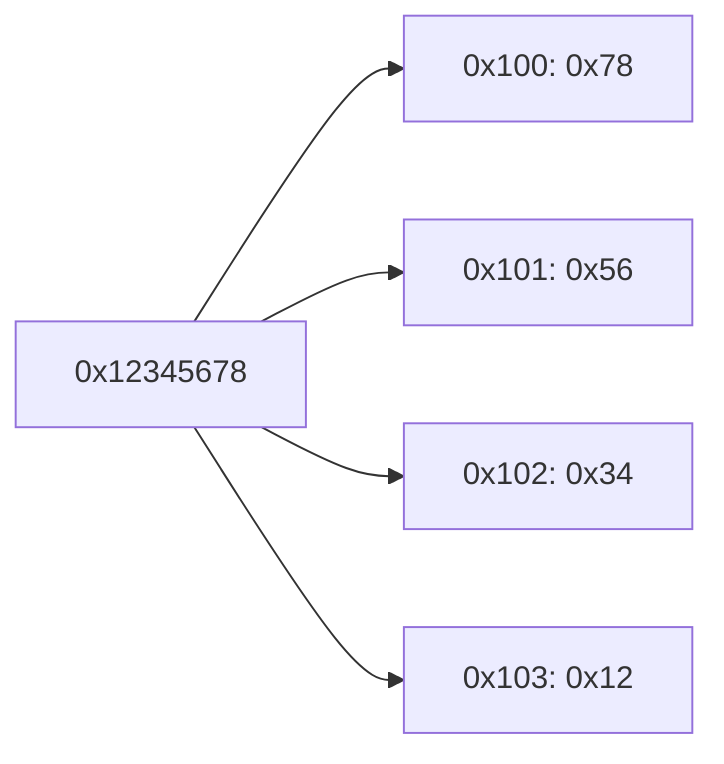
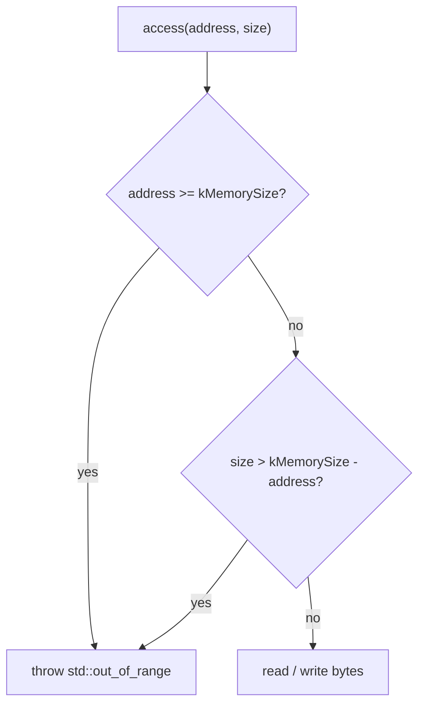

# Memory

`Memory` (`include/coresim/Memory.h`, `src/Memory.cpp`) emulates the RAM of CoreSim-16.

## Properties

| Property | Value |
|----------|-------|
| Size | 256 KB = 262,144 bytes (`kMemorySize`) |
| Addressing | Byte-addressable, 18-bit addresses |
| Valid range | `0x00000`–`0x3FFFF` |
| Byte order | Little-endian |
| Initial content | All bytes `0` |
| Storage | `std::vector<std::uint8_t>` |

## API

| Method | Description |
|--------|-------------|
| `Memory()` | Allocates 256 KB filled with `0` |
| `read8(address)` | Reads one byte |
| `write8(address, value)` | Writes one byte |
| `read32(address)` | Reads 4 bytes starting at `address` (little-endian) |
| `write32(address, value)` | Writes 4 bytes starting at `address` (little-endian) |
| `reset()` | Sets every byte back to `0` |
| `size()` | Returns the size in bytes (262,144) |

There is no alignment requirement: `read32`/`write32` work at any address as long as all 4 bytes are inside the memory.

## Little-endian layout

Multi-byte values are stored with the **lowest byte at the lowest address**.

```cpp
memory.write32(0x100, 0x12345678);
```

| Address | `0x100` | `0x101` | `0x102` | `0x103` |
|---------|---------|---------|---------|---------|
| Byte    | `0x78`  | `0x56`  | `0x34`  | `0x12`  |



`read32(0x100)` reassembles the bytes in the same order and returns `0x12345678`.

## Bounds checking

Every access is checked by the private helper `checkRange(address, size)` **before** any byte is read or written:

```cpp
if (address >= kMemorySize || size > kMemorySize - address) {
    throw std::out_of_range("Memory access out of bounds");
}
```



- The first condition rejects addresses outside the memory. It also prevents the unsigned underflow that `kMemorySize - address` would cause for large addresses such as `0xFFFFFFFF`.
- The second condition rejects multi-byte accesses that start inside but end outside the memory.
- Because the check runs first, a failing `write32` never writes part of the value.

| Access | Result |
|--------|--------|
| `write8(0x3FFFF, …)` | OK (last byte) |
| `write8(0x40000, …)` | throws |
| `write8(0xFFFFFFFF, …)` | throws |
| `write32(0x3FFFC, …)` | OK (ends at the last byte) |
| `write32(0x3FFFD, …)` | throws, memory unchanged |
| `read8` / `read32` | same rules as the writes |

Addresses never wrap around. An out-of-range access is always an error.
