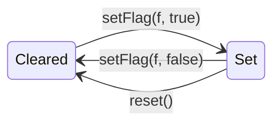

# Registers

CoreSim-16 has two groups of registers, both inside the CPU (not in RAM):

| Group | Class | Header |
|-------|-------|--------|
| 16 general-purpose registers R0–R15 | `Register` | `include/coresim/Register.h` |
| Special registers PC, SP, IR, DBR, FLAGS | `CPUState` | `include/coresim/CPUState.h` |

Both are owned by `CPU` and reachable through `cpu.registers()` and `cpu.state()`. `CPU::reset()` resets both.

## General-purpose registers (`Register`)

Despite its name, one `Register` object holds **all 16** registers.

| Property | Value |
|----------|-------|
| Count | 16 (`kRegisterCount`) |
| Width | 16 bit (`Word`) |
| Names | R0–R15 (index 0–15) |
| Initial value | `0` |
| Storage | `std::array<Word, 16>` |

| Method | Description |
|--------|-------------|
| `get(index)` | Returns the value of register `index` |
| `set(index, value)` | Stores `value` in register `index` |
| `reset()` | Sets all 16 registers to `0` |

An index ≥ 16 throws `std::out_of_range` (checked by the private helper `checkIndex`).

```cpp
cpu.registers().set(3, 0xBEEF);
Word v = cpu.registers().get(3);   // 0xBEEF
cpu.registers().get(16);           // throws std::out_of_range
```

The names R0–R15 are a notation only. In code, registers are addressed by their number.

## Special registers (`CPUState`)

| Register | Width | Getter / setter | Setter behaviour |
|----------|-------|-----------------|------------------|
| PC – program counter | 18 bit | `pc()` / `setPc()` | masked with `kAddressMask` (`0x3FFFF`) |
| SP – stack pointer | 18 bit | `sp()` / `setSp()` | masked with `kAddressMask` (`0x3FFFF`) |
| IR – instruction register | 32 bit | `ir()` / `setIr()` | stored unchanged |
| DBR – data bank register | 2 bit | `dbr()` / `setDbr()` | masked with `0x3` |
| FLAGS | 4 bit | `flag()` / `setFlag()` / `flags()` | see below |

All values start at `0`, and `reset()` sets them back to `0`.

### Masking

Setters never throw. They keep only the bits that fit into the register:

| Call | Stored value |
|------|--------------|
| `setPc(0x3FFFF)` | `0x3FFFF` |
| `setPc(0x40000)` | `0x00000` |
| `setSp(0x40001)` | `0x00001` |
| `setDbr(3)` | `3` |
| `setDbr(4)` | `0` |

```
value        = 0100 0000 0000 0000 0001   (0x40001)
kAddressMask = 0011 1111 1111 1111 1111   (0x3FFFF)
------------------------------------------ AND
result       = 0000 0000 0000 0000 0001   (0x00001)
```

### Flags

The FLAGS register holds four independent bits, defined in the `Flag` enum:

| Bit | Constant | Value | Name |
|-----|----------|-------|------|
| 0 | `kFlagZ` | `0x1` | Zero |
| 1 | `kFlagN` | `0x2` | Negative |
| 2 | `kFlagC` | `0x4` | Carry |
| 3 | `kFlagV` | `0x8` | Overflow |

```
flags = 0 0 0 0  V C N Z
                 3 2 1 0   ← bit
```

| Method | Description |
|--------|-------------|
| `flag(f)` | `true` if flag `f` is set |
| `setFlag(f, true)` | Sets flag `f` (`flags | f`), other flags unchanged |
| `setFlag(f, false)` | Clears flag `f` (`flags & ~f`), other flags unchanged |
| `flags()` | Returns all four bits as one number |

```cpp
CPUState& s = cpu.state();
s.setFlag(kFlagZ, true);
s.setFlag(kFlagC, true);
s.flags();            // 0x5  (Z + C)
s.setFlag(kFlagZ, false);
s.flag(kFlagC);       // still true
```



The flags are currently only changed through these methods. No instruction sets them yet.
