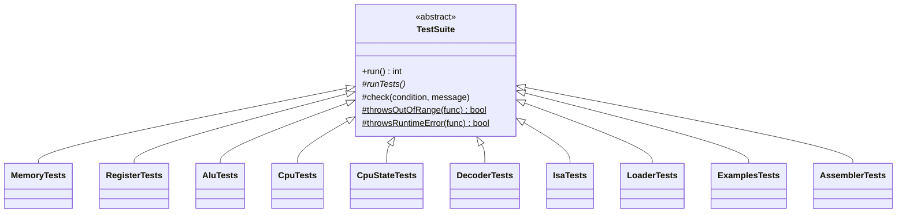
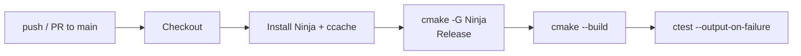

# Testing

CoreSim uses a small self-written test framework with no external dependencies. All tests are compiled into one executable, `coresim_tests`, which is registered with CTest.

## Running

```sh
cmake --build build
ctest --test-dir build --output-on-failure   # summary via CTest
./build/tests/coresim_tests                  # every single check
```

The test binary prints each check and a summary per suite:

```
  PASS [Memory]: memory is 256 KB
  ...
[Memory] passed
[Registers] passed
[ALU] passed
[CPU] passed
[CPUState] passed
[Decoder] passed
[Isa] passed
[Loader] passed
[Examples] passed
[Assembler] passed
All tests passed
```

Failed checks are printed as `FAIL [Suite]: message` on stderr, and the process exits with code `1`.

## Structure



| File | Purpose |
|------|---------|
| `tests/TestSuite.h` | Base class: `check()`, `throwsOutOfRange()`, `throwsRuntimeError()`, `run()` |
| `tests/test_main.cpp` | Runs every suite and adds up the failures |
| `tests/test_<name>.h/.cpp` | One suite per component |

| Helper | Description |
|--------|-------------|
| `check(condition, message)` | Records a PASS or FAIL |
| `throwsOutOfRange(func)` | `true` if calling `func` throws `std::out_of_range` |
| `throwsRuntimeError(func)` | `true` if calling `func` throws `std::runtime_error` |
| `run()` | Calls `runTests()`, prints the summary, returns the number of failures |

## What is covered

| Suite | File | Covers |
|-------|------|--------|
| Memory | `test_memory.cpp` | Size, little-endian `write32`/`read32` and `write16`/`read16`, untouched neighbour bytes, odd addresses, out-of-bounds reads and writes, no partial write on failure |
| Registers | `test_register.cpp` | R0–R15 hold independent values, full 16-bit range, `reset()`, index 16 throws |
| ALU | `test_alu.cpp` | Result and Z, N, C, V of all nine operations without a CPU: normal values, zero results, `0xFFFF`, carry, borrow, signed overflow, `MUL` overflow, unsigned `DIV`, `DIV` by zero throws, `CMP` has no result to write, `NOT` ignores its second operand |
| CPU | `test_cpu.cpp` | Register access through the CPU, `CPU::reset()` clears registers and state, `step()` fetches into IR and advances PC by 4, `NOP` keeps running, `HLT` halts, a halted CPU does not fetch, `reset()` clears halted, `MOVI` loads an immediate, `MOV` copies a register and keeps the source, neither changes the flags, `ADD` and `ADDI` results, unchanged operands, 16-bit wrap-around, Z, N, C and V including signed overflow, `ADDI` with destination equal to source, `SUB` results, borrow, signed overflow, clearing an old Z, destination equal to source, `CMP` flags for equal, smaller and larger operands and signed overflow, `CMP` writes no register even with a set `rd` field, integration of `MUL`, `DIV`, `AND`, `OR`, `XOR` and `NOT` with the ALU, `DIV` by zero keeps `rd` and the flags and has advanced PC, `MOV`, `MOVI`, `LOAD`, `STORE`, `PUSH`, `POP`, `OUT`, `NOP` and `HLT` keep the flags, `JMP` skips the next instruction and continues at the target, ignores the unused bits and reaches `0x3FFFC`, `JMP` to itself, `JZ`, `JNZ`, `JN` and `JC` taken and not taken after `CMP`, jumps keep the flags, `JN` does not jump after a signed overflow, `LOAD` and `STORE` with positive and negative offsets, DBR banks, wrap-around inside the bank, `rd` equal to `rs1`, a `STORE`/`LOAD` round-trip, an access at `0x3FFFF` throws and keeps register and memory unchanged, neither changes the flags, `PUSH` wraps SP from `0x00000` to `0x3FFFE` and ignores the `rd` field and DBR, `POP` after `PUSH` and last-in-first-out order, `CALL` with the example from `ISA.md`, nested `CALL`/`RET`, `RET` masks the stored value to 18 bits, failing stack accesses throw and keep SP, PC and registers, the stack instructions keep the flags, `OUT` writes unsigned decimal lines into a captured `std::ostringstream` and ignores the `rd` field, the default output stream is `std::cout`, `run()` until `HLT`, on a halted CPU, stopped by `maxSteps` in an endless loop, continued after the limit, `run(0)`, a countdown program that prints 3, 2 and 1 |
| CPUState | `test_cpu_state.cpp` | Initial values, 18-bit masking of PC/SP, 2-bit masking of DBR, 32-bit IR, setting/clearing single flags, `reset()` |
| Decoder | `test_decoder.cpp` | One case per format (R `0x12345000`, I `0x4123ABCD`, M `0x8012FFFC`/`0x80120008`, J `0xC0012345`/`0xFFFFFFFF`), negative and positive offset, 18-bit address masking |
| Isa | `test_isa.cpp` | Value of all 26 opcodes, each opcode lies in the range of its format (`opcode >> 6`), operand encoding of `STORE`, `LOAD`, `PUSH`, `POP`, `MOVI`, `CALL` and `HLT` |
| Loader | `test_loader.cpp` | Counting instruction lines with comments, blank lines, tabs and `\r\n`, load addresses from `0x00000` in steps of 4, little-endian, lower case and the `0x`/`0X` prefix, `00000000` to `FFFFFFFF`, memory after the program is kept, a loaded countdown runs on the CPU, invalid lines (wrong digit count, non-hex characters, two values, lone `0x`) throw with the correct line number, earlier lines are already written, 65,536 instructions fit, one more throws `out_of_range` |
| Examples | `test_examples.cpp` | Every program in `examples/` is found, loads the expected number of instructions, halts within 1,000,000 steps and prints the expected output (`countdown`, `factorial`, `fibonacci`, `squares`), every `.asm` example assembles to exactly the instructions of its `.hex` file and prints the same, a missing file is reported |
| Assembler | `test_assembler.cpp` | `parseLine()`: empty, whitespace-only and comment-only lines have no parts, instructions with 0, 1 and 3 operands, a comment after an instruction, spaces and tabs before the comment are no operand, spaces and tabs around the mnemonic, the commas and the label are trimmed, a tab between mnemonic and operand, a label before an instruction, alone, before a comment and without a space after `:`, `[R1 + 8]` stays one operand, letter case is kept. `assemble()`: encoding of all 26 instructions, R0 to R15, decimal, negative and hex numbers at the range limits, memory operands with positive, negative, hex and limit offsets, jump targets as numbers, letter case of mnemonics and registers, empty programs, `\r\n`, the countdown from `ASSEMBLER.md`, labels defined further down, at address 0, alone in a line, after the last instruction, indented, with `_` and digits, letter case of labels. Every error from `ASSEMBLER.md` with its exact message and line number, 65,536 instructions fit and one more does not. `loadAsm()` writes little-endian from `0x00000`, returns the count and leaves memory unchanged after an error |

### Example programs

The `Examples` suite reads the files from `examples/` directly, so a change to the CPU that breaks an example also fails the tests and the CI. The path comes from CMake:

```cmake
# tests/CMakeLists.txt
target_compile_definitions(coresim_tests PRIVATE CORESIM_EXAMPLES_DIR="${PROJECT_SOURCE_DIR}/examples")
```

`CORESIM_EXAMPLES_DIR` is the absolute path to `examples/`, so the tests find the files no matter which directory they are started from. A new example needs its own checks in `test_examples.cpp`.

## Adding a suite

1. Create `tests/test_<name>.h` with a class deriving from `TestSuite` and overriding `runTests()`.
2. Write the checks in `tests/test_<name>.cpp`.
3. Add the `.cpp` file to `tests/CMakeLists.txt`.
4. Include the header in `tests/test_main.cpp` and add `failures += <Name>Tests().run();`.

## Continuous integration

`.github/workflows/ci.yml` builds and tests the project on every push and pull request to `main`, and can be started manually.



The job runs on `ubuntu-latest` and fails if the build or any test fails. Compiler output is cached with ccache between runs.
