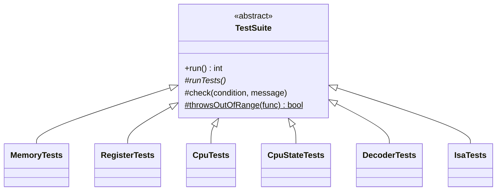
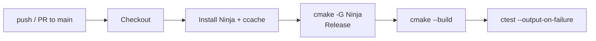

# Testing

CoreSim uses a small self-written test framework with no external dependencies. All tests are compiled into one executable, `coresim_tests`, which is registered with CTest.

## Running

```sh
cmake --build build
ctest --test-dir build --output-on-failure   # summary via CTest
./build/tests/coresim_tests                  # every single check
```

The test binary prints each check and a summary per suite:

```
  PASS [Memory]: memory is 256 KB
  ...
[Memory] passed
[Registers] passed
[CPU] passed
[CPUState] passed
[Decoder] passed
[Isa] passed
All tests passed
```

Failed checks are printed as `FAIL [Suite]: message` on stderr, and the process exits with code `1`.

## Structure



| File | Purpose |
|------|---------|
| `tests/TestSuite.h` | Base class: `check()`, `throwsOutOfRange()`, `run()` |
| `tests/test_main.cpp` | Runs every suite and adds up the failures |
| `tests/test_<name>.h/.cpp` | One suite per component |

| Helper | Description |
|--------|-------------|
| `check(condition, message)` | Records a PASS or FAIL |
| `throwsOutOfRange(func)` | `true` if calling `func` throws `std::out_of_range` |
| `run()` | Calls `runTests()`, prints the summary, returns the number of failures |

## What is covered

| Suite | File | Covers |
|-------|------|--------|
| Memory | `test_memory.cpp` | Size, little-endian `write32`/`read32`, out-of-bounds reads and writes, no partial write on failure |
| Registers | `test_register.cpp` | R0–R15 hold independent values, full 16-bit range, `reset()`, index 16 throws |
| CPU | `test_cpu.cpp` | Register access through the CPU, `CPU::reset()` clears registers and state |
| CPUState | `test_cpu_state.cpp` | Initial values, 18-bit masking of PC/SP, 2-bit masking of DBR, 32-bit IR, setting/clearing single flags, `reset()` |
| Decoder | `test_decoder.cpp` | One case per format (R `0x12345000`, I `0x4123ABCD`, M `0x8012FFFC`/`0x80120008`, J `0xC0012345`/`0xFFFFFFFF`), negative and positive offset, 18-bit address masking |
| Isa | `test_isa.cpp` | Value of all 26 opcodes, each opcode lies in the range of its format (`opcode >> 6`) |

## Adding a suite

1. Create `tests/test_<name>.h` with a class deriving from `TestSuite` and overriding `runTests()`.
2. Write the checks in `tests/test_<name>.cpp`.
3. Add the `.cpp` file to `tests/CMakeLists.txt`.
4. Include the header in `tests/test_main.cpp` and add `failures += <Name>Tests().run();`.

## Continuous integration

`.github/workflows/ci.yml` builds and tests the project on every push and pull request to `main`, and can be started manually.



The job runs on `ubuntu-latest` and fails if the build or any test fails. Compiler output is cached with ccache between runs.
